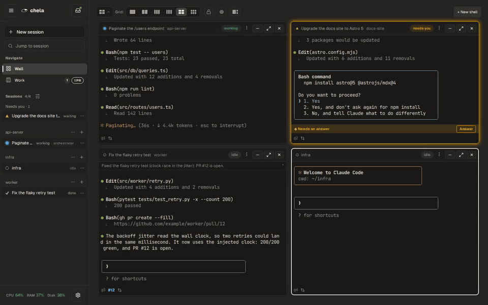
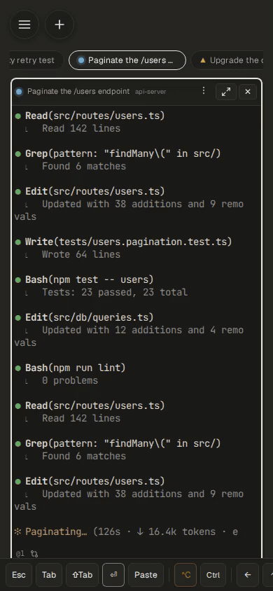

<p align="center">
  
</p>

<table align="center">
  <tr>
    <td align="center" valign="top">
      <br>
      <sub>Desktop: the Wall, Work (board, runs, schedules) &amp; Settings on <kbd>Ctrl</kbd>+<kbd>,</kbd></sub>
    </td>
    <td align="center" valign="top">
      <br>
      <sub>Phone: pill switcher, “+” New session, keybar</sub>
    </td>
  </tr>
</table>

<p align="center"><sub>Recorded from a synthetic demo fleet (<a href="scripts/demo/"><code>scripts/demo/</code></a>. Re-record with <code>scripts/demo/record.sh</code>.</sub></p>

<p align="center">
  <a href="LICENSE"></a>
  
  
  
</p>

# chelamux

**Run Claude Code agents unattended. chela only merges a PR once it has proved the tests
catch broken code.**

- **Tracker-driven dispatch.** A ready task in Linear, GitHub issues or a `TODO.md` becomes
  one git worktree, one agent and one PR.
- **A mutation-testing judge.** Before a merge, the judge corrupts the code the PR guards and
  checks the tests turn red; its verdict is bound to the PR's head commit, so a new push
  voids it.
- **A merge gate with one-tap approval.** `chela merge` refuses without a clean verdict on
  the current head and green CI; `chela merge --override --reason …` asks you instead, and
  one Telegram tap (or the dashboard) completes it, and the override is audited.

And you can watch it all live: a terminal-wall dashboard, a Telegram bridge to every
session, and schedules that poke long-lived agents (`--every 1h`, cron, or once).

> **Trust note.** Dispatched agents run **unsandboxed by default**, as your user, with your
> tools and network. A measured sandbox exists and is **opt-in per workflow**
> (`agent.sandbox: true` in `WORKFLOW.md`); see
> [docs/TRUST_AND_APPROVAL_POSTURE.md](docs/TRUST_AND_APPROVAL_POSTURE.md).

## Try the judge on your own repo (no setup)

The judge's mechanical half runs on its own: no tmux, no dispatcher, no tracker, no API key.
`chela judge sweep` corrupts every conditional, comparison and return code your branch
changed (`if x > 100:` → `if False and (x > 100):`, `==` → `!=`, `0` ↔ `1`…), runs your
tests against each, restores the file, and fails on every mutation the tests did not catch.
From your branch's checkout:

```bash
uvx --with pytest --from git+https://github.com/Devail1/chelamux chela judge sweep --base origin/main
```

```text
  [1/2] calc.py:8 if-false
  [2/2] calc.py:8 compare-flip
  suite: `python -m pytest -q`, detected (tests/)
  1 changed file(s) NOT swept: only Python (and .js/.mjs/.ts/.tsx, line-based) is mutated; each is UNKNOWN, not clean
  [SURVIVED] calc.py:8 if-false: `if x > 100:` → `if False and (x > 100):`
  [SURVIVED] calc.py:8 compare-flip: `if x > 100:` → `if x <= 100:`
  [UNKNOWN ] tool.go is not supported: only Python (and .js/.mjs/.ts/.tsx, line-based) is mutated
sweep: 2 mutation(s): 0 killed, 2 survived, 0 skipped (1.0s)
⚖️ Each SURVIVED line is a changed check no test can tell apart from its corruption. Add a test that goes RED under that mutation, not a weaker assertion.
```

The suite runs inside the `uvx` environment, so give it your test deps the same way
(`--with-requirements requirements.txt`), or name the suite yourself with `--test-cmd`.
Without `--base` it diffs against `origin/HEAD` (the remote's default branch), else
`origin/dev`.

On a pull request, as a GitHub Action (only `GITHUB_TOKEN`; it comments the survivors and
fails the job):

```yaml
      - uses: actions/checkout@v4
        with: { fetch-depth: 0 }
      - uses: Devail1/chelamux@v0       # after your own "install the test deps" step
```

`@v0` follows every 0.x release (each release moves it). For a fully reproducible job, pin a
release tag such as `@v0.17.0`, or that release's commit SHA.

The job needs `permissions: pull-requests: write` to comment. The suite is detected
(pytest / `npm test` / `go test` / `cargo test`) or given as `test-cmd:` / `--test-cmd`.
Exit codes: `0` clean · `1` survivors · `2` cannot verify (red baseline, base not found) ·
`3` **unknown** (nothing survived, but a changed file could not be swept). Survivors win:
the run above exits `1`. `--json` prints the result as JSON. Mutations happen in place but
never outlive the run: each one is restored in a `finally`, and a guardian process restores
it if the run is `kill -9`ed.

## Install

Requires Linux, WSL or macOS · Python ≥ 3.11 · `tmux` · `git` · [`uv`](https://docs.astral.sh/uv/) ·
the `claude` CLI · `gh` (for the PR flow).

```bash
git clone https://github.com/Devail1/chelamux && cd chelamux
uv sync --all-extras          # core + dashboard + Telegram bridge, in one command
uv run chela status           # what chela sees
```

Full walkthrough, clone to a first agent-opened PR:
[**docs/GETTING_STARTED.md**](docs/GETTING_STARTED.md).

chela never touches credentials: it drives the `claude` CLI in your tmux windows (run
`claude` and `/login` once), so the whole fleet runs as **one Claude account** and shares
its 5h / 7d limits. Inside Claude Code, add the hooks plugin too
(`/plugin marketplace add Devail1/chelamux`, then `/plugin install chela@chela`). It powers
blocked-agent handling, answering from your phone, and the merge gate
([docs/HOOKS.md](docs/HOOKS.md)).

## First run

```bash
tmux new-session -d -s chela -n researcher        # a window = an agent
uv run chela status                               # what chela sees
uv run chela schedule add researcher --every 1h --prompt "Run your research cycle."
uv run chela run                                  # the daemon; leave it running
uv run chela dashboard                            # http://127.0.0.1:5001
```

> **`chela run` is the engine, not a helper.** The scheduler, the dispatcher, the
> needs-input scan and the decisions inbox all live in its loop. Kill it and nothing *looks*
> broken (the dashboard still works and agents still run), but the fleet stops doing
> anything by itself.

To dispatch work, follow [**docs/GETTING_STARTED.md**](docs/GETTING_STARTED.md) (about
10 minutes, clone to a first agent-opened PR). Prefer an agent to set it up? Copy
[`skills/chela-setup`](skills/chela-setup/SKILL.md) into `~/.claude/skills/`.

## What's new in 0.16

- **`chela judge sweep`** mutates every conditional, comparison and return code a branch
  changed and lists each one no test catches. A dispatched agent's `chela task-finished` runs
  it (budgeted) and refuses while a mutation survives; it also refuses a diff over 300 changed
  lines. The sweep runs in any git repo too: `chela judge sweep --base origin/main --test-cmd
  "pytest -q"`. See [docs/RUNS.md](docs/RUNS.md#the-sweep-on-its-own).
- **`chela release X.Y.Z --theme "…"`** prepares the release locally; one tap pushes `main`,
  the tag and `dev`.
- **Pending approvals on the dashboard.** A ⚖️ pill approves or denies override and release
  requests without Telegram.
- **The orchestrator's inbox hears what it used to find by hand**: CI red on a PR's head, a
  PR turning conflicting, a stuck agent, a judge that never started, every approval outcome,
  and the agent's own `--handoff` note.
- **Dispatched agents inherit an allowlisted environment**, not the daemon's. See
  [TRUST §2](docs/TRUST_AND_APPROVAL_POSTURE.md#2-what-a-dispatched-agent-can-do-execution--sandbox).
- **The sidebar follows you across devices**, hold <kbd>Alt</kbd> to number its rows, and a
  window's name follows its session's folder. See [docs/DASHBOARD.md](docs/DASHBOARD.md).

Full list: [CHANGELOG.md](CHANGELOG.md).

## Documentation

**[chela.pages.dev/docs](https://chela.pages.dev/docs)** is the user guide: concepts,
scheduling, dispatching, the orchestration loop, agent rooms, permission modes, the
dashboard, collaborative terminals, the command reference and configuration.

In-repo references ([index](docs/README.md)): [GETTING_STARTED.md](docs/GETTING_STARTED.md) ·
[RUNS.md](docs/RUNS.md) · [DASHBOARD.md](docs/DASHBOARD.md) · [CONFIG.md](docs/CONFIG.md) ·
[LINEAR_TRACKER.md](docs/LINEAR_TRACKER.md) · [RISK_LEVELS.md](docs/RISK_LEVELS.md) ·
[HOOKS.md](docs/HOOKS.md) · [EVENTS.md](docs/EVENTS.md) ·
[TRUST_AND_APPROVAL_POSTURE.md](docs/TRUST_AND_APPROVAL_POSTURE.md) ·
[ESCALATION_CONTRACT.md](docs/ESCALATION_CONTRACT.md) ·
[RESOURCE_ISOLATION.md](docs/RESOURCE_ISOLATION.md).

## Status

Early. Core (scheduler + dispatcher + messaging) is solid and tested; CI runs the suite on
Python 3.11 and 3.13. The dashboard and live terminal wall are first-class but ship as an
optional extra, so a headless install can skip them (`uv sync` alone is core only). The
wall serves **writable shells**, so it is on by default but
**loopback-guarded**: a non-loopback bind refuses it unless you set
`CHELA_TERMINALS_EXPOSE=true`. Front it with a tailnet or an SSH tunnel.

[Changelog](CHANGELOG.md) · [Contributing](CONTRIBUTING.md) · [Security policy](SECURITY.md) ·
[Code of Conduct](CODE_OF_CONDUCT.md)

## Credits

The work-item dispatcher is an adaptation of OpenAI's **Symphony** pattern (task-list →
isolated git worktree → autonomous agent → PR); chela does not claim novelty for that shape.

## License

Copyright © 2026 Liav Edry. **GNU Affero General Public License v3.0 or later**. See
[LICENSE](LICENSE).

AGPL rather than GPL because chela is a long-running daemon with a web dashboard: plain
GPL obligations trigger on *distribution*, so running a modified chela as a hosted service
would carry none. In plain terms: use it freely, privately or commercially, and modify it
as you like; if you distribute a modified version **or run one as a network service**,
publish your source under the same licence.

Versions up to and including **0.3.0 were released under MIT** and remain available under
it. Third-party components keep their own licences; see [NOTICE](NOTICE).
